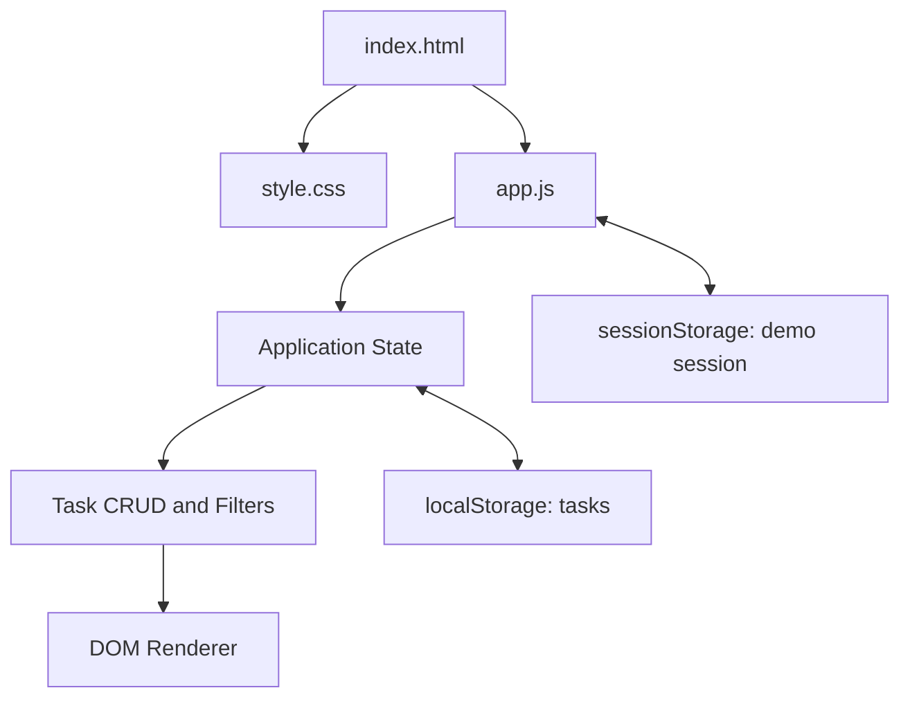

# Orbit — Production Capstone Project

Orbit is a responsive task-manager web application built as a portfolio/internship capstone. It demonstrates simulated authentication, task CRUD, filtering/search, status updates, summary statistics, and persistent browser storage.

## Features
- **Simulated sign-in:** uses a name and email to enter a local demo workspace. This is not real server-side authentication.
- **Create, read, update, delete:** create and edit tasks, change status, mark complete, and delete with confirmation.
- **Dynamic task views:** All tasks, Due today, Completed.
- **Live search and filters:** search title/description and filter by priority/status.
- **Persistent state:** tasks stored in `localStorage`; demo session stored in `sessionStorage`.
- **Responsive UI:** desktop sidebar adapts to a compact mobile navigation.
- **Accessibility:** semantic landmarks, labelled inputs, focus indicators, dialog, table headers, skip link, and status announcements.

## Tech stack
- HTML5
- CSS custom properties, Grid, Flexbox, responsive media queries
- Vanilla JavaScript (ES modules, state updates, DOM APIs)
- Web Storage API

## Architecture

## Run locally
No build tools or package installation are required:
1. Download/extract the project.
2. Open `index.html` in a modern browser. If your browser blocks local scripts, start a local server from this folder with `python -m http.server 8000`.
3. Visit `http://localhost:8000`.

## Deploy
### GitHub Pages
1. Create a public GitHub repository.
2. Upload `index.html`, `style.css`, `app.js`, and `README.md`.
3. Open **Settings → Pages**.
4. Select the `main` branch and `/ (root)`, then save.
5. Wait for the published URL shown in Pages settings.

### Netlify
1. Open Netlify and choose **Add new site → Deploy manually**.
2. Drag the extracted project folder into the deployment drop zone.
3. Copy the generated public URL.

## Important security note
The sign-in screen is only a UI simulation. It does not authenticate users, protect data, or send credentials to a backend. Do not enter a real password. A production release would require secure server-side authentication, authorization, database storage, validation, and security monitoring.

## Evaluation checklist
- [ ] Test sign-in form validation.
- [ ] Create, edit, complete, filter, search, and delete tasks.
- [ ] Refresh and confirm tasks persist.
- [ ] Test narrow mobile width and desktop layout.
- [ ] Capture desktop and mobile screenshots.
- [ ] Publish the repository and add the deployed URL here.

**Repository URL:** _Add your GitHub repository link_  
**Live deployment URL:** _Add your public deployment link_
